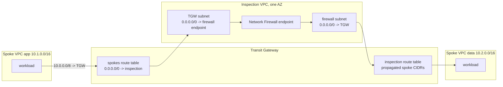

# Transit Gateway hub-and-spoke with central inspection

A Terraform module that builds an AWS Transit Gateway hub, an inspection
VPC with an AWS Network Firewall endpoint, attachments for your spoke VPCs,
and the route tables that force all spoke-to-spoke traffic through the
firewall.

> **Status:** `terraform validate` and 10 `terraform test` runs against a
> mocked AWS provider: one full apply-with-mocks that checks every routing
> hop and appliance mode, one that checks spoke isolation (no default route
> tables, no spoke propagation into the spokes table) and the inspection
> subnet route table associations, one where the firewall has no endpoint
> in the chosen AZ and the plan must fail, one rule-set check, and six
> rejected inputs.
> **Nothing has been planned or applied against AWS**, so real behaviour
> (endpoint creation, route propagation timing) is untested.
> **Scope:** AWS Transit Gateway + Network Firewall only. Azure Virtual WAN
> and Azure Firewall are not implemented.

## Problem

> Create a Terraform module for a transit gateway / virtual WAN
> hub-and-spoke architecture with centralized inspection (AWS Network
> Firewall / Azure Firewall).

Why it matters: with many VPCs, full-mesh peering or a flat transit gateway
lets any VPC reach any other without a check in between. Routing every
spoke-to-spoke flow through one firewall gives a single place to see and
control east-west traffic.

## Traffic path



1. Spoke route tables send `10.0.0.0/8` (configurable) to the TGW.
2. Spoke attachments are associated with the **spokes** TGW route table,
   which has one route: `0.0.0.0/0` to the inspection attachment. Spokes
   never learn each other's routes, so they can't bypass inspection.
3. In the inspection VPC, the TGW subnet routes everything to the firewall
   endpoint; the firewall subnet routes everything back to the TGW.
4. The inspection attachment is associated with the **inspection** route
   table, which has the spoke CIDRs propagated into it, so inspected
   traffic reaches the right spoke.
5. **Appliance mode** is on for the inspection attachment, so both
   directions of a flow use the same firewall endpoint (stateful rules
   need that).

The TGW default route table association and propagation are disabled, so
no attachment lands anywhere by accident.

## Design choice: one AZ for the firewall

The module puts the firewall endpoint and the TGW attachment subnet in a
**single AZ**. That was the simpler option.

| | Single AZ (this module) | Endpoint per AZ |
|---|---|---|
| Resources | 2 subnets, 1 endpoint | 2 subnets + route table per AZ |
| Cost | one endpoint-hour charge | one per AZ |
| Failure | an AZ outage stops all inspected traffic | survives one AZ |
| Data path | spokes in other AZs cross AZs (inter-AZ data charges, latency) | traffic stays in its AZ |

For production, use one endpoint per AZ and a TGW subnet route table per
AZ pointing at that AZ's endpoint.

## The firewall rules are an example

`firewall.tf` has one stateful rule group with two rules: pass TCP on
`allowed_tcp_port` (default 443) and drop all other IP traffic. It exists to
show where rules go. Replace it with your own policy.

## Usage

```hcl
module "hub" {
  source = "github.com/zeinhaidara/36-terraform-transit-gateway-hub-spoke"

  name              = "example-hub"
  availability_zone = "eu-west-2a"

  spokes = {
    app = {
      vpc_id          = "vpc-0aaaaaaaaaaaaaaa1"
      cidr            = "10.1.0.0/16"
      subnet_ids      = ["subnet-0aaaaaaaaaaaaaa01"]
      route_table_ids = ["rtb-0aaaaaaaaaaaaaa01"]
    }
  }
}
```

`examples/hub-spoke` builds two placeholder spoke VPCs and calls the module.

### Run the checks locally (same as CI)

```bash
terraform fmt -check -recursive
terraform init -backend=false
terraform validate
terraform test

cd examples/hub-spoke
terraform init -backend=false -lockfile=readonly
terraform validate
```

## Inputs

| Name | Default | Notes |
|---|---|---|
| `name` | required | prefix for names |
| `availability_zone` | required | AZ for the firewall endpoint |
| `spokes` | required | map of `vpc_id`, `cidr`, `subnet_ids`, `route_table_ids`; at least one, unique CIDRs |
| `inspection_vpc_cidr` | `100.64.0.0/26` | `/27` or larger; two `/28`s are used |
| `amazon_side_asn` | `64512` | private 16-bit ASN |
| `spoke_route_cidr` | `10.0.0.0/8` | added to each spoke route table |
| `allowed_tcp_port` | `443` | the example pass rule |
| `tags` | `{}` | applied to all resources |

## Cost note

Transit Gateway and Network Firewall both charge **per hour** (per
attachment and per firewall endpoint) **and per GB processed**. Traffic
between spokes is processed by the TGW twice and by the firewall once.
This is not a free-tier setup; check current AWS pricing before applying.

## Limits

- AWS only; Azure is not implemented.
- East-west inspection only. There is no internet egress (no NAT or IGW)
  in the inspection VPC.
- Single-AZ firewall endpoint (see trade-off above). If the firewall has
  no endpoint in `availability_zone`, the plan fails with a clear message
  instead of creating a route with no target.
- No firewall logging or VPC flow logs are configured.
- Spoke VPCs, their subnets, and their route tables must already exist.
- Network Firewall can now also attach directly to a Transit Gateway
  without an inspection VPC. That newer option is not used here; check the
  provider version and AWS docs if you prefer it.

## Versions

- Terraform `>= 1.9.0, < 2.0.0`; CI uses 1.15.8 (sha256 checked).
- `hashicorp/aws` `>= 6.0, < 7.0` in the module; the example pins `6.73.0`.
- `.terraform.lock.hcl` is committed only in `examples/hub-spoke`.

## Security notes

- Spokes can't reach each other without passing the firewall, because the
  spokes route table has only the default route to inspection.
- `auto_accept_shared_attachments` is off.
- No credentials, state, or backend in the repo. IDs in examples and tests
  are placeholders.

## Idempotency

Plain declarative Terraform. Re-applying with the same inputs is a no-op;
adding a spoke adds one attachment, association, propagation and its
spoke routes without touching the others.
